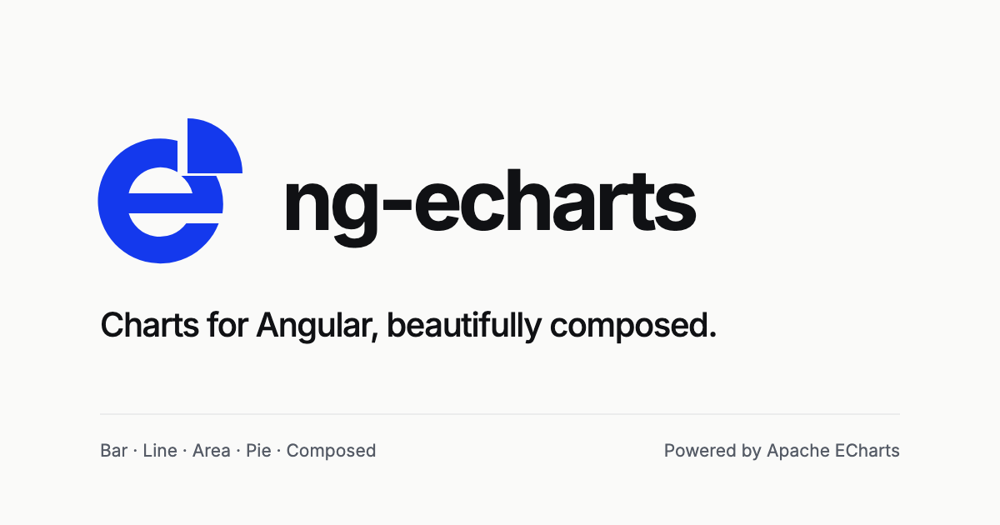

# ng-echarts

An Angular 22 chart component library inspired by EvilCharts, using Apache ECharts for rendering and TypeScript for its public API.

Preview: **[Live demo on GitHub Pages](https://phalla-doll.github.io/ng-echarts/)**. See [deployment instructions](docs/GITHUB_PAGES.md) to rebuild and publish the current demo snapshot.

Status: experimental bar, line, area, pie/donut, composed, focused radar, radial progress, calendar heatmap and Sankey components. Updated 14 November 2026. The Angular library and SSR playground now render bars, lines, areas, and pies/donuts with native controls; G1 technical feasibility passes for bar; the user has deferred the human screen-reader review to release acceptance, allowing development to continue while G2 remains pending.

## Project direction

Build native Angular components, beginning with the upstream ECharts implementations. Preserve the selected visual designs and interactions while replacing React lifecycle, composition, state, and overlays with Angular equivalents. Validate one bar chart before expanding to the MVP collection.

`ng-echarts` is the project name. The user selected `@mantha911/ng-echarts` for the experimental npm prerelease, published under the `next` dist-tag. Human screen-reader interpretation remains unreviewed at the user’s request; human release gates are not marked passed.

```sh
npm install @mantha911/ng-echarts@next echarts@6.1.0
```

## Documents

| Document | Purpose |
| --- | --- |
| [Brand identity](docs/BRANDING.md) | Orbit e logo, icons, social preview and asset regeneration |
| [Product specification](docs/PRODUCT_SPEC.md) | Users, scope, behavior, requirements, and acceptance criteria |
| [Local installation](docs/INSTALLATION.md) | Pack/install workflow, pinned fresh CLI application, bootstrap and SSR configuration |
| [Integration guide](docs/INTEGRATION_GUIDE.md) | Complete four-chart application, API/type index, updates, events and accessibility |
| [Radial progress API](docs/RADIAL_PROGRESS_API.md) | Scalar completion, native semantics, states and experimental limits |
| [Calendar heatmap API](docs/CALENDAR_HEATMAP_API.md) | Single-year date/value contract, fixed scale and native daily actions |
| [Sankey API](docs/SANKEY_CHART_API.md) | Directed acyclic node/link data, native totals and plot/table selection |
| [Radar API](docs/RADAR_CHART_API.md) | Explicit dimension scales, comparison profiles, native table and experimental limits |
| [Compatibility and limits](docs/COMPATIBILITY.md) | Exact tested versions, peer contracts, browser coverage, measured envelopes and exclusions |
| [Local release checklist](docs/RELEASE_CHECKLIST.md) | Candidate preparation, exact-tarball consumer checks, MIT/notices and remaining release gates |
| [Preview deployment hardening](docs/experiments/PREVIEW_DEPLOYMENT_HARDENING.md) | Immutable build provenance, clean-commit publishing, verification receipts and stale-build rejection |
| [GitHub Pages preview](docs/GITHUB_PAGES.md) | Live URL, static subpath build, local/live verification, notices and manual republishing |
| [Implementation plan](docs/IMPLEMENTATION_PLAN.md) | Delivery increments, scaffold boundaries, and developer workflow |
| [Upstream provenance](docs/UPSTREAM_PROVENANCE.md) | Pinned fixtures, reuse decisions, and adapted-file notices |
| [Bar prototype evidence](docs/experiments/BAR_PROTOTYPE.md) | Implemented behavior, test results, captures, and open research |
| [Comparison page alignment](docs/experiments/COMPARISON_PAGE_ALIGNMENT.md) | Shared sidebar/theme/typography for comparisons, explicit measurement mode, and before/after evidence |
| [Chart presentation refinement](docs/experiments/PREMIUM_CHART_REFINEMENT.md) | All nine families, stable states, clearer data encodings, quantitative legends and before/after comparisons |
| [Four-family visual audit](docs/experiments/VISUAL_AUDIT.md) | Official ECharts and EvilCharts review, mobile refinements, both-theme captures and browser evidence |
| [Visual comparison](docs/experiments/R03_VISUAL_REVIEW.md) | Pinned upstream comparisons at three host widths and remaining alignment work |
| [Playground layout review](docs/experiments/PLAYGROUND_LAYOUT_REVIEW.md) | Responsive site design, before/after captures, navigation, and interface checks |
| [Bar gallery correction](docs/experiments/BAR_GALLERY_VISUAL_REVIEW.md) | Reference-aligned home page, four existing bar variants, copyable Angular examples, and verification |
| [Site-wide theme alignment](docs/experiments/SITE_THEME_ALIGNMENT.md) | Consistent documentation/tools, setup and component pages, and a shared theme across navigation |
| [UI spacing review](docs/experiments/UI_SPACING_REVIEW.md) | Shared gutters, aligned headings, consistent panels/controls, breakpoint checks, and before/after captures |
| [Code presentation](docs/experiments/CODE_PRESENTATION_REVIEW.md) | Google Sans Code, theme-aware syntax colors, and corrected copy actions |
| [Demo performance audit](docs/experiments/DEMO_PERFORMANCE_AUDIT.md) | Cold/cached loading, mobile CPU work and ranked findings |
| [Demo performance improvements](docs/experiments/DEMO_PERFORMANCE_FIXES.md) | Modular concept delivery, viewport rendering and route performance checks |
| [Area-block reference audit](docs/experiments/AREA_BLOCKS_VISUAL_AUDIT.md) | User's visual target, current layout gaps, and gallery correction brief |
| [Linked selection feedback](docs/experiments/LINKED_SELECTION_FEEDBACK.md) | Persistent month feedback, current table row, reset and rc.2 evidence |
| [Shared focus refinement](docs/experiments/FOCUS_REFINEMENT.md) | Consistent thin focus rings across demo controls, keyboard scroll regions and both themes |
| [Hover and press refinement](docs/experiments/HOVER_REFINEMENT.md) | Role-specific button/link feedback, preserved selection cues, touch and reduced-motion checks |
| [Linked UI refinement](docs/experiments/LINKED_UI_REFINEMENT.md) | Before/after control, spacing, card and mobile review for the linked demo |
| [Month preview follow-up](docs/experiments/NG20_MONTH_PREVIEWS.md) | Opt-in hover/focus context, mobile tap safeguard and current verification |
| [Linked charts guide](docs/LINKED_CHARTS.md) | Application-owned month/range selection, keyboard actions, resets, updates and a complete compiled example |
| [Graphical range selection](docs/experiments/GRAPHICAL_RANGE_SELECTION.md) | Snapped pointer selection, native equivalence, cancellation, touch/focus review and rc.4 evidence |
| [Native month ranges](docs/experiments/NG20_MONTH_RANGE.md) | Inclusive range contract, multi-row feedback, visual review and rc.3 verification |
| [Composed API reference](docs/COMPOSED_CHART_API.md) | Shared-axis vertical bars and lines, typed descriptors and stable controls |
| [Pie/donut API reference](docs/PIE_CHART_API.md) | Single-measure categories, responsive radii, labels, visibility, and raw events |
| [NG13 pie/donut implementation](docs/experiments/NG13_PIE_CHART.md) | Pie/donut source comparisons, package isolation, browser behavior, and performance |
| [Area API reference](docs/AREA_CHART_API.md) | Independent gradient/solid fills, same-sign stacks, gap/event semantics, and integration |
| [NG12 area implementation](docs/experiments/NG12_AREA_CHART.md) | Area source comparisons, gallery, package isolation, browser geometry checks, and performance |
| [Line API reference](docs/LINE_CHART_API.md) | Multi-series lines, interpolation/points/gaps, shared inputs/events, and local integration |
| [NG11 line implementation](docs/experiments/NG11_LINE_CHART.md) | Line source comparisons, gallery, package isolation, browser behavior, and performance |
| [Bar API reference](docs/BAR_CHART_API.md) | Implemented inputs/defaults, events, integration, formatting, versions, and limits |
| [Foundation/bar acceptance](docs/experiments/NG09_NG10_ACCEPTANCE.md) | NG09/NG10 implementation checklist, bar requirement evidence, and remaining release checks |
| [Cross-family acceptance](docs/experiments/NG14_CROSS_FAMILY_ACCEPTANCE.md) | F01–F10 reconciliation, 100-cycle cleanup, actual Angular interaction/resize measurements, and deferred human evidence |
| [Documentation acceptance](docs/experiments/NG15_DOCUMENTATION.md) | Reproducible first-install/bootstrap path, complete examples, compatibility review and fresh-consumer evidence |
| [Package boundaries](docs/experiments/NG09_PACKAGE_BOUNDARIES.md) | Focused core/bar imports, compatible root API, strict packed consumers, and module/size checks |
| [Shared value formatting](docs/experiments/NG09_SHARED_FORMATTING.md) | Currency/percentage options, custom numeric text, and consistent axis/tooltip/table behavior |
| [Lifecycle and hydration validation](docs/experiments/R04_R05_VALIDATION.md) | Three-browser results, input/focus/retention, teardown, and hydration |
| [Renderer and cost](docs/experiments/R07_RENDERER_COST.md) | Actual Angular timings, Canvas/SVG comparison, data envelope, and size budget |
| [Packed runtime](docs/experiments/R08_PACKED_RUNTIME.md) | Isolated client/SSR production builds and three-browser package checks |
| [Screen-reader review](docs/experiments/R06_MANUAL_REVIEW.md) | Deferred human listening checklist, required before release acceptance |
| [Research findings](docs/RESEARCH_FINDINGS.md) | Upstream inventory, verified compatibility facts, reuse assessment, and unknowns |
| [Technical architecture](docs/TECHNICAL_ARCHITECTURE.md) | Implemented Angular design, public API, rendering lifecycle, and provisional release decisions |
| [Research and development plan](docs/RND_PLAN.md) | Experiments, deliverables, decision gates, and effort estimates |
| [Delivery backlog](docs/BACKLOG.md) | Ordered implementation tasks and release checks |
| [Acceptance matrix](docs/ACCEPTANCE_MATRIX.md) | Requirements mapped to experiments, delivery tasks, and release evidence |
| [Sources](docs/SOURCES.md) | Primary references and the pinned upstream revision |

## How the plans fit together

The product specification defines scope and required behavior. Research findings own the checked toolchain ranges and upstream facts. The architecture describes how to meet the specification; the R&D plan resolves uncertainties before the backlog expands the implementation. The acceptance matrix connects these documents without replacing their detailed criteria.

Keep the four-family MVP separate from later chart families and advanced visual variants. The bar prototype establishes feasibility; it does not establish release readiness for the other charts. Decisions remain provisional until the relevant experiment passes and its evidence is recorded.

Before coding, read the [template and derived-state conventions](docs/TECHNICAL_ARCHITECTURE.md#templates-and-derived-state). They apply Angular's template guidance to chart states, legends, accessible tables, and the renderer boundary.

## Development

The demo also includes **Chart possibilities** at `/chart-possibilities`: twelve interactive proposals matching the collection's visual style, with filters, sample tables and the shared theme. The [standalone HTML gallery](docs/experiments/chart-style-gallery.html) works offline. See its [integration record](docs/experiments/CHART_POSSIBILITIES.md); these concepts do not add public library APIs.

Use Node 24.22.2 (`.nvmrc`) and npm 11.19.1. Angular/CLI 22.2.6, TypeScript 6.0.3, RxJS 7.8.2, and ECharts 6.1.0 are locked for the initial experiments.

```sh
npm ci
npx playwright install chromium firefox webkit
npm run build:lib
npm start -- --port 4310
```

Open `http://localhost:4310` for the bar-block gallery, or `http://localhost:4310/playground` for interactive settings. In another terminal, run `npm run watch:lib` while editing the library. The playground consumes its built package from `dist/chart-library`.

The site includes [Get Started](http://localhost:4310/get-started), [Installation](http://localhost:4310/installation), and [Components](http://localhost:4310/components). Site text and chart labels use local Inter with whole CSS pixel sizes and line heights. All pages share the neutral styling and a dark-by-default theme; the header toggle retains its choice during client-side navigation. Measurement fixtures keep their own chart conditions.

| Command | Purpose |
| --- | --- |
| `npm run build` | Build the library and production browser/server playground |
| `npm run build:pages` / `npm run check:pages` | Build and verify the static demo under its GitHub project path |
| `npm run deploy:pages` | Rebuild, verify and publish the current demo to the dedicated `gh-pages` branch |
| `npm test` | Run library and playground Vitest tests once |
| `npm run test:browser` | Run Chromium, Firefox, and WebKit scenarios against the production SSR build |
| `npm run reference:prepare` | Prepare the isolated pinned React reference source and build its harness |
| `npm run capture:pie` | Capture pinned pie/donut references, both themes, and narrow labeled galleries |
| `npm run benchmark:pie` | Measure actual Angular donut mount/update and table cost at 12/100 categories |
| `npm run capture:area` | Capture pinned area references and Angular variants in both themes and three host widths |
| `npm run benchmark:area` | Measure actual Angular stacked-gradient area mount/update and table cost |
| `npm run capture:line` | Capture pinned line references and Angular variants in both themes and three host widths |
| `npm run benchmark:line` | Measure actual Angular line mount/update and expanded-table cost |
| `npm run capture:bar` | Capture all four reference variants at three widths/two themes, plus narrow tooltips |
| `npm run typecheck` | Strict Angular/TypeScript compilation with `skipLibCheck: false` |
| `npm run check:consumer` | Check a built tarball's declarations in an isolated Angular consumer |
| `npm run check:docs` | Execute the installation guide in a fresh CLI app, compile its exact example and verify three-engine hydration/actions |
| `npm run check:runtime` | Build/run isolated client and SSR consumers in all three browser engines |
| `npm run benchmark:bar` | Measure actual Angular mount/update and compare production Canvas/SVG harnesses |
| `npm run benchmark:acceptance` | Measure all four Angular families: normal/stress mount, update, legend interaction, resize, cold loading, and tables |
| `npm run check:bundle` | Check core/bar/root module boundaries and size budgets, excluding Angular/RxJS peers |
| `npm run check:ssr` | Check production server markup and hydration metadata after a build |
| `npm run format` / `npm run format:check` | Apply/check Prettier formatting |
| `npm run check` | Run formatting, builds, compilation, unit, declaration/runtime consumers, SSR, browser, and size checks |

The [preview-only checkpoint](docs/experiments/NG20_MONTH_PREVIEWS.md) records **260 fresh unit tests, 46 final targeted browser passes and six exact rc.15 installed client/SSR modes**. A separate full browser baseline passed 362 cases before the final focus corrections; its scope is preserved in that report. Human release acceptance remains pending.

The earlier completed full workspace check records **257 unit tests and 353 passing browser scenarios, with four expected skips**, plus strict installed declarations, documented installation, SSR, six client/SSR modes and twelve package-budget scenarios. The [presentation receipt](docs/experiments/data/premium-visual-refinement.json) binds that run to its source snapshot and 138 reviewed visual states. The later [WebKit font-readiness fix](docs/experiments/DEMO_PERFORMANCE_FIXES.md#webkit-embedded-font-readiness-follow-up) separately passes 30 targeted concept/performance scenarios in all three engines; it is not presented as a new complete-suite count. The [deployment record](docs/GITHUB_PAGES.md#rc11-sankey-presentation-and-webkit-deployment) identifies the verified public source, 34 static routes and 16 route budgets. CI uses all three engines. ESLint and a numeric coverage threshold are not configured.

The [visual review](docs/experiments/R03_VISUAL_REVIEW.md) records 80 current captures and accepted bar differences. R01–R05, [R07 renderer/cost](docs/experiments/R07_RENDERER_COST.md), and [R08 packed consumption](docs/experiments/R08_PACKED_RUNTIME.md) pass for bar. Canvas meets the normal 200×3 benchmark target and the measured size budget. G1 passes; G2 requires the [R06 listening result](docs/experiments/R06_MANUAL_REVIEW.md). The user has deferred that human review to release acceptance; it no longer blocks development. Automated cross-family evidence is reconciled in [NG14](docs/experiments/NG14_CROSS_FAMILY_ACCEPTANCE.md); human interpretation and final release evidence remain pending.

## Target environment

Angular 22 with strict TypeScript and template checking. The selected toolchain follows the supported ranges recorded in [research findings](docs/RESEARCH_FINDINGS.md#angular-22-toolchain).

## Implemented chart families

Package entries below follow `@mantha911/ng-echarts`. All chart entries are experimental; implementation completion does not close NG14 or the release gates.

| Component | Entry | Gallery / behavior fixture | API and evidence |
| --- | --- | --- | --- |
| `BarChart<T>` | `/bar` | `/` / `/playground`, `/validation` | [API](docs/BAR_CHART_API.md), [bar acceptance](docs/experiments/NG09_NG10_ACCEPTANCE.md) |
| `LineChart<T>` | `/line` | `/line` / `/line-validation` | [API](docs/LINE_CHART_API.md), [NG11](docs/experiments/NG11_LINE_CHART.md) |
| `AreaChart<T>` | `/area` | `/area` / `/area-validation` | [API](docs/AREA_CHART_API.md), [NG12](docs/experiments/NG12_AREA_CHART.md) |
| `ComposedChart<T>` | `/composed` | `/composed` / `/composed-validation` | [API](docs/COMPOSED_CHART_API.md), [NG17](docs/experiments/NG17_COMPOSED_CHART.md) |
| `PieChart<T>` (pie and donut) | `/pie` | `/pie` / `/pie-validation` | [API](docs/PIE_CHART_API.md), [NG13](docs/experiments/NG13_PIE_CHART.md) |
| `RadarChart<T>` | `/radar` | `/radar` | [API](docs/RADAR_CHART_API.md), [NG18](docs/experiments/NG18_RADAR_CHART.md) |
| `RadialProgress` | `/radial` | `/radial` | [API](docs/RADIAL_PROGRESS_API.md), [NG18](docs/experiments/NG18_RADIAL_PROGRESS.md) |
| `CalendarHeatmap<T>` | `/calendar` | `/calendar` | [API](docs/CALENDAR_HEATMAP_API.md), [NG19](docs/experiments/NG19_CALENDAR_HEATMAP.md) |
| `SankeyChart<N, L>` | `/sankey` | `/sankey` | [API](docs/SANKEY_CHART_API.md), [NG19](docs/experiments/NG19_SANKEY_CHART.md) |

Cartesian charts take `series: readonly ChartSeries<T>[]`; pie/donut takes one `measure: ChartMeasure<T>`. Cartesian legend events identify a `seriesId`; pie legend events identify a `rowId`. Both point events retain the original row and numeric value. See the guides for zero/missing/negative rules and optional keyboard table actions.

Focused families keep the 200,000 gzip / 175,000 Brotli byte cap; `/core` keeps 10,000/9,000. The combined compatibility root uses 219,500/187,500; its frame-only emitted-orphan scenario keeps 203,000/175,000. [Current measured boundaries](docs/experiments/data/package-boundaries.json) include all lazy chunks; prefer focused imports.

## Bar feasibility baseline

Build a standalone Angular bar chart with typed data, light and dark themes, responsive resizing, tooltip, selectable legend, reduced motion, and safe destruction. Prove that it works in both a client application and an application using server rendering and hydration. Use its measured results to decide the MVP architecture.

NG09/NG10 implementation is complete for the current foundation/bar baseline; NG11 line charts are implemented; NG12 area charts are implemented; NG13 pie/donut is implemented; [NG14 automated cross-family acceptance](docs/experiments/NG14_CROSS_FAMILY_ACCEPTANCE.md) is recorded, with human interpretation still pending. [NG15 installation/integration documentation](docs/experiments/NG15_DOCUMENTATION.md) and fresh-consumer verification are complete. NG16 local artifact verification is complete; [NG17 composed charts](docs/experiments/NG17_COMPOSED_CHART.md) add the first post-MVP extension. [NG20 linked charts](docs/experiments/NG20_LINKED_CHARTS.md) add an application-owned overview/detail example using the existing events; inclusive native and graphical month ranges are implemented; broader zoom/hover and disjoint/two-way selection remain deferred. Human interpretation and release gates remain open.

The `/pie` page presents browser shares, donuts, and outside labels in the same gallery design. `/pie-validation` exercises single-measure category behavior and deferred hydration.

The `/area` page presents independent gradients, stacks, solid fills, and missing observations using the same gallery design. `/area-validation` exercises area behavior and deferred hydration.

The `/line` page presents straight/smooth lines, optional points, and missing-value gaps using the same gallery design. `/line-validation` exercises line behavior and deferred hydration.

The home page presents the existing grouped, stacked, gradient, and horizontal bars in a neutral gallery with code/preview controls, calculated totals, copyable Angular examples, and light/dark themes. The `/playground` route retains the pinned Desktop/Mobile fixture and grouped settings. It retains layout, stack, gradient, state, update, and remount controls. `@mantha911/ng-echarts` is the experimental public package identity. ECharts is a peer dependency. Adapted fixture data and colors are tracked in the provenance ledger with the upstream MIT notice.

The `/composed` gallery combines monthly visits and a trailing three-month mean on one visits scale, with the same preview/code controls and themes. `/composed-validation` provides state, kind-change, keyboard and deferred-hydration checks. See the [composed API](docs/COMPOSED_CHART_API.md) for the typed bar/line contract and current limits.

The `/linked` page connects a monthly visits overview to device share through stable month IDs. Plot clicks, keyboard table actions and a native selector update the companion chart; All months or Reset clears the filter. `/linked-validation` covers immutable updates, reordering, removal and missing/empty recovery. The [guide](docs/LINKED_CHARTS.md) supplies the displayed, strictly compiled standalone example. The controlled `selectedRowId` bar input (rc.2+) reflects the month with a category band, focused bar colors and a current-row table label. See the [selection-feedback review](docs/experiments/LINKED_SELECTION_FEEDBACK.md).

## Library license

Original chart-library code is [MIT licensed](projects/chart-library/LICENSE). See its [third-party notices](projects/chart-library/THIRD_PARTY_NOTICES.md) for preserved upstream/dependency terms. The published experimental prerelease is `@mantha911/ng-echarts@0.1.0-rc.18`; follow the [release checklist](docs/RELEASE_CHECKLIST.md) to prepare and verify it.


## NG18 radar first increment

The user-approved [radar increment](docs/experiments/NG18_RADAR_CHART.md) adds the focused `/radar` Angular entry and a site-aligned demo with explicit dimension maxima, stable comparisons, missing-data policy, native scale/value table and vertex/table actions. The [API](docs/RADAR_CHART_API.md) defines the bounded contract. The subsequent radial-progress increment is also implemented below. The compatibility root and four-family MVP retain their scope; private rc.5 is separate from the preserved rc.4 artifact. Human F09/R06/G2/G3/G4 and public publication remain pending.


## NG18 radial progress increment

The user-approved [radial progress increment](docs/experiments/NG18_RADIAL_PROGRESS.md) adds the focused `/radial` Angular entry and two demo examples. Required scalar value and explicit positive maximum supply native progress semantics, visible formatted values and a noninteractive ring. The [API](docs/RADIAL_PROGRESS_API.md) defines zero/null/invalid states, formatting, motion and SSR behavior. This advances the private candidate to rc.6 while preserving rc.5 and earlier artifacts and the existing compatibility root. Native progress provides the scalar alternative; legends, point actions and a data table are inapplicable. Human interpretation and public release gates remain pending.

Calendar heatmaps: [experimental API](docs/CALENDAR_HEATMAP_API.md), [NG19 evidence](docs/experiments/NG19_CALENDAR_HEATMAP.md), and the `/calendar` demo. One explicit year and fixed maximum preserve date identity and missing-vs-zero behavior.

Experimental Sankey flows: [API](docs/SANKEY_CHART_API.md), [NG19 record](docs/experiments/NG19_SANKEY_CHART.md), and the `/sankey` demo. Directed acyclic node/link data retain native totals, zero links and equivalent plot/table actions. Private rc.10 preserves rc.9, rc.8; human interpretation and public release remain pending.

Private rc.11 introduced Sankey and independent lazy engine loading with the completed [chart presentation refinement](docs/experiments/PREMIUM_CHART_REFINEMENT.md). Earlier candidates remain preserved; [release evidence](docs/RELEASE_CHECKLIST.md) keeps human release gates separate.

Private rc.12 corrects the packaged documentation and preserves the rc.11 implementation and archive. [The release checklist](docs/RELEASE_CHECKLIST.md) records exact-artifact verification; library publication and human release gates remain pending.


The [combined preview/performance checkpoint](docs/experiments/COMBINED_PREVIEW_PERFORMANCE.md) records the current **266 unit tests, 380 browser passes (four expected skips), all twelve package budgets and six exact rc.16 installed client/SSR modes**. It retains the earlier experiment/candidate scopes and pending human release gates.


The [rc.17 release review](docs/experiments/RC17_RELEASE_REVIEW.md) records the loading-theme correction, CI follow-up and exact-artifact verification. The [human result sheet](docs/experiments/RC17_HUMAN_REVIEW.md) remains pending under the user’s explicit prerelease deferral; [public package preparation](docs/PUBLICATION.md) records the selected npm identity and exact-artifact workflow.


The [NG22 public prerelease](docs/experiments/NG22_PUBLIC_PRERELEASE.md) uses `@mantha911/ng-echarts@0.1.0-rc.18` with npm public access and the `next` tag. The user selected the authenticated personal scope and explicitly skipped the listening session while requesting this experimental publication. Earlier private candidates remain preserved; human F09/R06/G2/G3/G4 remain pending.


[The first public prerelease](docs/experiments/NG22_PUBLIC_PRERELEASE.md#completed-publication) is available on npm. Registry bytes match the verified archive and fresh registry consumers pass. npm retains both `next` and its initial `latest` alias for rc.18; this is an experimental prerelease, with human listening still deferred at the user’s request.
